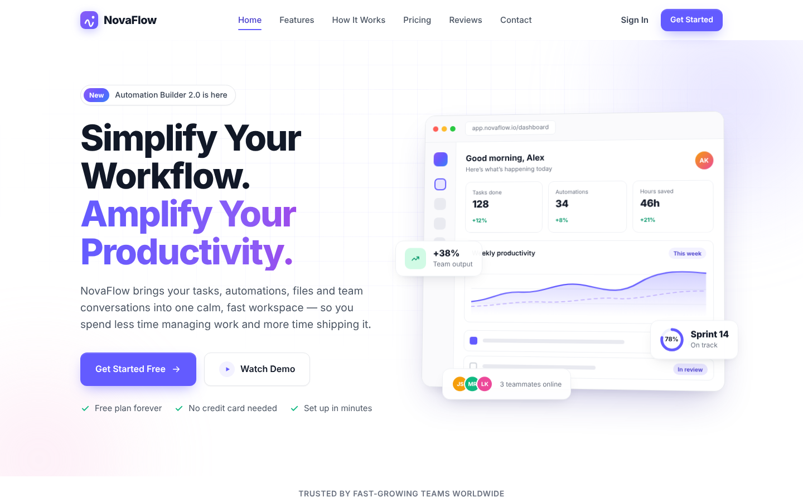
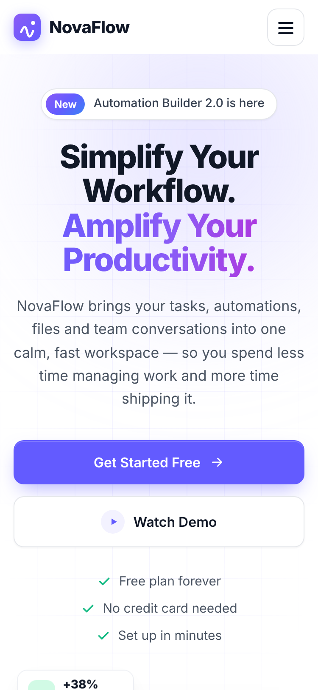

# NovaFlow — Premium SaaS Landing Page

A complete, responsive, one-page SaaS marketing website for **NovaFlow**, a fictional workflow and productivity platform. Built from scratch with **pure HTML5, CSS3 and vanilla JavaScript** — no frameworks, no libraries, no build step.

> NovaFlow is a fictional product created as a portfolio project. Company logos, pricing and testimonials are demonstration content.

**Live demo:** https://YOUR-GITHUB-USERNAME.github.io/novaflow-landing-page/ _(replace after deploying)_



---

## ✨ Features

- **Sticky header** with blur effect, active-section highlighting and an accessible mobile hamburger menu (Esc to close, focus management)
- **Hero section** with gradient headline, CTAs, a CSS-built dashboard mockup and animated floating stat cards
- **Trusted-by strip** with five monochrome SVG wordmarks (fictional brands)
- **Six feature cards** with custom SVG icons and hover animations
- **How It Works** three-step timeline
- **Product preview** — a realistic dashboard built entirely in HTML/CSS/SVG: sidebar, KPI cards, line chart, donut progress, bar chart, task overview and recent activity (no chart libraries)
- **Pricing** with a working monthly/yearly toggle (20% annual discount)
- **Testimonials** clearly labelled as illustrative
- **FAQ accordion** following the WAI-ARIA pattern (arrow-key, Home/End navigation)
- **Contact form** with client-side validation and a clear demo-only confirmation (no data is sent anywhere)
- **Footer** with navigation, social links and Back to Top button, plus a floating scroll-to-top button
- **Subtle scroll-reveal animations** that respect `prefers-reduced-motion`

## 📱 Responsive

Tested at 320px, 375px, 768px, 1024px and 1440px widths with no horizontal scrolling. Touch targets are at least 44px.

| Desktop | Mobile |
| --- | --- |
|  |  |

## ♿ Accessibility & SEO

- Semantic landmarks (`header`, `nav`, `main`, `section`, `footer`) and a skip link
- Visible `:focus-visible` states and full keyboard support
- ARIA attributes for the menu, pricing switch, accordion and form errors
- Text alternatives for charts and logos
- Meta description, Open Graph/Twitter tags, JSON-LD structured data and an SVG favicon

Lighthouse targets are 90+ for Performance, Accessibility, Best Practices and SEO. Run your own audit in Chrome DevTools → Lighthouse after deploying to record real scores.

## 🛠 Technologies

- HTML5
- CSS3 (custom properties, Grid, Flexbox, media queries, keyframe animations)
- Vanilla JavaScript (ES5-compatible, no dependencies)
- Google Fonts (Inter)
- Inline SVG icons and charts

## 📁 Project Structure

```
novaflow-landing-page/
├── index.html
├── css/
│   └── style.css
├── js/
│   └── script.js
├── assets/
│   ├── images/   (og-image, screenshots)
│   └── icons/    (favicon, logo, apple-touch-icon)
├── README.md
├── LICENSE
└── .gitignore
```

## 🚀 Installation

1. Clone the repository:
   ```bash
   git clone https://github.com/YOUR-GITHUB-USERNAME/novaflow-landing-page.git
   cd novaflow-landing-page
   ```
2. Open `index.html` in any modern browser — that's it.

Optional: serve it locally (useful for testing Lighthouse):
```bash
python3 -m http.server 8000
# then visit http://localhost:8000
```
Or use the **Live Server** extension in VS Code.

## 🌐 Deploying to GitHub Pages

1. Push the project to a public GitHub repository.
2. Open the repository → **Settings** → **Pages**.
3. Under **Build and deployment**, set **Source** to **Deploy from a branch**.
4. Choose the `main` branch and the `/ (root)` folder, then click **Save**.
5. After a minute or two your site will be live at
   `https://YOUR-GITHUB-USERNAME.github.io/novaflow-landing-page/`.
6. Update the live demo link at the top of this README (and optionally change the `og:image` URL in `index.html` to the full absolute URL so social previews work everywhere).

## 📸 Screenshots

Screenshots live in `assets/images/`. Replace them with fresh captures if you change the design.

## 👤 Developer

Designed and developed by **Anis Jamil**.

## 📄 License

Released under the [MIT License](LICENSE).
